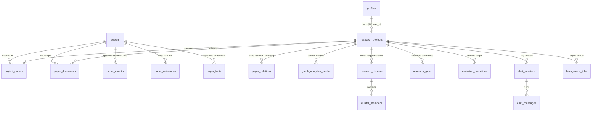

# ResearchGraphAI Database Architecture & DBMS Notes

## 1. Entity-Relationship Diagram



---

## 2. Relational Normalization, Functional Dependencies & JSONB Rationale

### Normalized Core (BCNF / 3NF)
- **`papers`**: Candidate keys `{id}`, `{doi}` (partial/unique), `{title_hash}` (unique). Functional dependencies: `id -> {doi, title, abstract, authors, year, venue, citation_count}`. Shared across projects cleanly without duplicating paper metadata.
- **`project_papers`**: Pure M:N junction table solving multi-project membership with project-specific state: `(project_id, paper_id) -> {rank, relevance_score, selected, processing_status, abstract_only, sources}`. Eliminates transitive dependency and deletion anomalies.
- **`paper_relations`**: `(project_id, source_id, target_id, relation_type)` enforces per-project edge typing (`cites`, `similar`, `coupling`) with `directed` boolean distinguishing citation DAG edges from undirected mutual k-NN similarity & Jaccard coupling edges.
- **`graph_analytics_cache`** & **`research_gaps`**: Keyed by `(project_id, corpus_version)` (+ `statement_hash` on `research_gaps`) so stale caches and duplicate gap records are prevented declaratively by PostgreSQL `UNIQUE` constraints rather than application-only checks.

### Why PostgreSQL + `JSONB` for Semi-Structured Fields (`paper_facts`, `evidence_rows`, `filters`)
- Extracted LLM schema attributes (`research_question`, `method`, `limitations`, `metrics`) each bundle `{value, quote, chunk_id, page, verified}`. Storing 10 fields x 5 nested sub-keys relationally would produce 50 sparse nullable columns or complex 5-way joins, whereas typed `JSONB` preserves schema agility, atomic row reads, and GIN indexability while core foreign keys (`paper_id`, `project_id`) remain strictly relational.

---

## 3. Views, Materialized Views, Triggers, Recursive CTEs & Window Functions

Implemented in [`f60708091006_t15_dbms_views_trigger.py`](../backend/alembic/versions/f60708091006_t15_dbms_views_trigger.py) and [`dbms_queries.py`](../backend/app/services/dbms_queries.py):
1. **`v_project_paper_stats` (View)**: Replaces N+1 `COUNT(*)` loops in `GET /projects` with a single `LEFT JOIN` aggregate (`total_papers`, `selected_papers`, `processed_papers`, `avg_citation_count`, `min_year`, `max_year`).
2. **`mv_field_growth` (Materialized View)**: Pre-aggregates per-project publication year counts and citation sums (`ix_mv_field_growth_proj_year`); refreshed explicitly via `POST /projects/{id}/stats/refresh` (zero GET side effects).
3. **`trg_project_papers_bump_corpus_version` (PL/pgSQL Trigger)**: Fires `AFTER INSERT OR DELETE ON project_papers FOR EACH ROW` to increment `research_projects.corpus_version` and `updated_at`, automatically invalidating stale graph analytics & gap caches.
4. **`WITH RECURSIVE` Ancestor Traversal (`GET /projects/{id}/ancestors`)**: Traverses multi-hop citation ancestors (`relation_type = 'cites'`) with an `ARRAY[...]` cycle guard (`NOT (r.target_id = ANY(a.path))`), matching pure-Python DSA BFS depth results identically.
5. **SQL Window Function (`GET /projects/{id}/cluster-representatives`)**: Uses `RANK() OVER (PARTITION BY cm.cluster_id ORDER BY COALESCE(p.citation_count, 0) DESC, p.id ASC)` to select top representative papers per cluster in a single scan.

---

## 4. Measured `EXPLAIN (ANALYZE, BUFFERS)` Plans (Live Supabase PostgreSQL)

### Query 1 — Full-Text Search with Generated `tsvector` & GIN Index (`13.719 ms`)
```text
Limit  (cost=9.50..9.50 rows=1 width=12) (actual time=13.143..13.146 rows=4 loops=1)
  Buffers: shared hit=47
  ->  Sort  (cost=9.50..9.50 rows=1 width=12) (actual time=13.141..13.143 rows=4 loops=1)
        Sort Key: (ts_rank_cd(text_tsv, '''graph'' & ''neural'''::tsquery)) DESC
        Sort Method: quicksort  Memory: 25kB
        ->  Bitmap Heap Scan on paper_chunks  (cost=8.37..9.49 rows=1 width=12) (actual time=9.561..13.120 rows=4 loops=1)
              Recheck Cond: (text_tsv @@ '''graph'' & ''neural'''::tsquery)
              ->  Bitmap Index Scan on ix_paper_chunks_text_tsv_gin  (cost=0.00..8.37 rows=1 width=0) (actual time=4.187..4.188 rows=4 loops=1)
Planning Time: 29.260 ms | Execution Time: 13.719 ms
```

### Query 2 — Dense Cosine Similarity via `pgvector` HNSW Index (`50.060 ms`)
```text
Limit  (cost=119.87..129.47 rows=20 width=24) (actual time=10.065..49.928 rows=20 loops=1)
  Buffers: shared hit=479
  ->  Index Scan using ix_paper_chunks_embedding_hnsw on paper_chunks  (cost=119.87..656.51 rows=1118 width=24) (actual time=10.064..49.913 rows=20 loops=1)
        Order By: (embedding <=> ...)
Planning Time: 0.907 ms | Execution Time: 50.060 ms
```

### Query 3 — `WITH RECURSIVE` Citation Ancestors (`1.681 ms`)
```text
HashAggregate  (cost=17.06..17.18 rows=11 width=8) (actual time=1.612..1.614 rows=0 loops=1)
  CTE ancestors
    ->  Recursive Union  (cost=0.14..16.79 rows=11 width=40) (actual time=1.609..1.610 rows=0 loops=1)
          ->  Index Scan using ix_paper_relations_relation_type on paper_relations r  (cost=0.14..1.27 rows=1 width=40)
          ->  Hash Join  (cost=1.28..1.54 rows=1 width=40)
                Join Filter: (r_1.target_id <> ALL (a.path))
Planning Time: 0.742 ms | Execution Time: 1.681 ms
```

---

## 5. Transaction Isolation & Job Queue Concurrency (`FOR UPDATE SKIP LOCKED`)

Background workers (`JobService` in [`backend/app/services/jobs.py`](../backend/app/services/jobs.py)) poll `background_jobs` inside a `READ COMMITTED` transaction using `SELECT ... WHERE status = 'pending' FOR UPDATE SKIP LOCKED LIMIT 1`.
- **Why `SKIP LOCKED`?** Under standard `SELECT` without row locking, two workers reading simultaneously both claim the same pending job (lost-update race). Under `FOR UPDATE` without `SKIP LOCKED`, Worker B blocks waiting for Worker A to commit instead of advancing to the next queued job. `SKIP LOCKED` atomically locks one unclaimed row for Worker A while allowing Worker B to immediately skip locked rows and pick up Job #2 with zero blocking or double execution.

---

## 6. Architecture & Security: PostgreSQL+pgvector+JSONB vs MongoDB + Supabase RLS

| Dimension | PostgreSQL + `pgvector` + `JSONB` (Chosen) | MongoDB Document Store |
|---|---|---|
| **Consistency / CAP** | Strong ACID (CP/CA single-primary transactional integrity) | Eventual consistency by default across shards; multi-doc ACID added overhead |
| **Vector + Relational Joins** | Native single-engine SQL joins (`paper_chunks <=> vec` filtered by `project_papers`) | Requires separate `$vectorSearch` / external vector DB without FK integrity |
| **Schema Enforcement** | Strict FK cascades, `UNIQUE` constraints, triggers, views | Application-enforced references |

### Supabase Row-Level Security (RLS) Policy Examples
```sql
ALTER TABLE research_projects ENABLE ROW LEVEL SECURITY;
CREATE POLICY project_owner_policy ON research_projects
    FOR ALL USING (auth.uid()::text = user_id);

ALTER TABLE project_papers ENABLE ROW LEVEL SECURITY;
CREATE POLICY project_papers_owner_policy ON project_papers
    FOR ALL USING (
        EXISTS (
            SELECT 1 FROM research_projects rp
            WHERE rp.id = project_papers.project_id
              AND rp.user_id = auth.uid()::text
        )
    );
```
